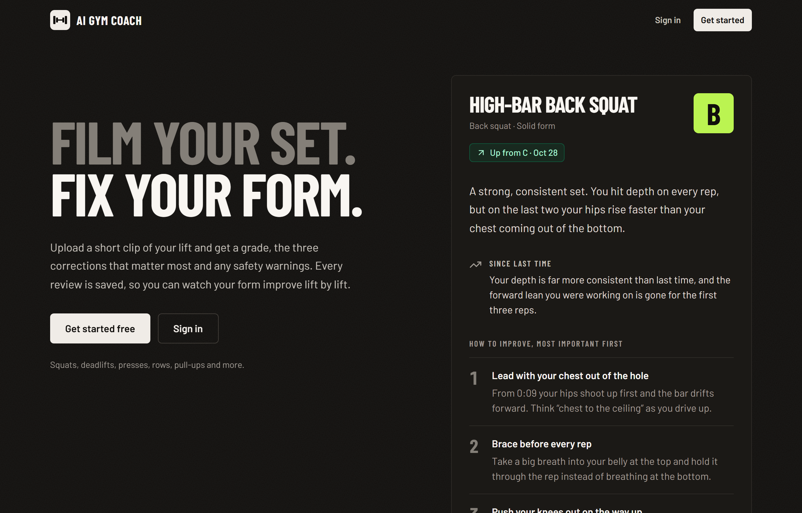
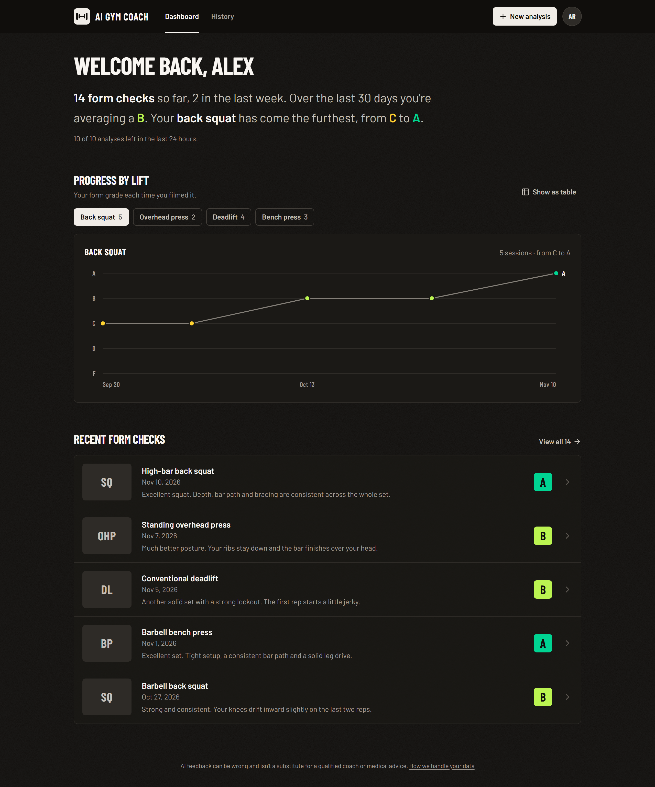
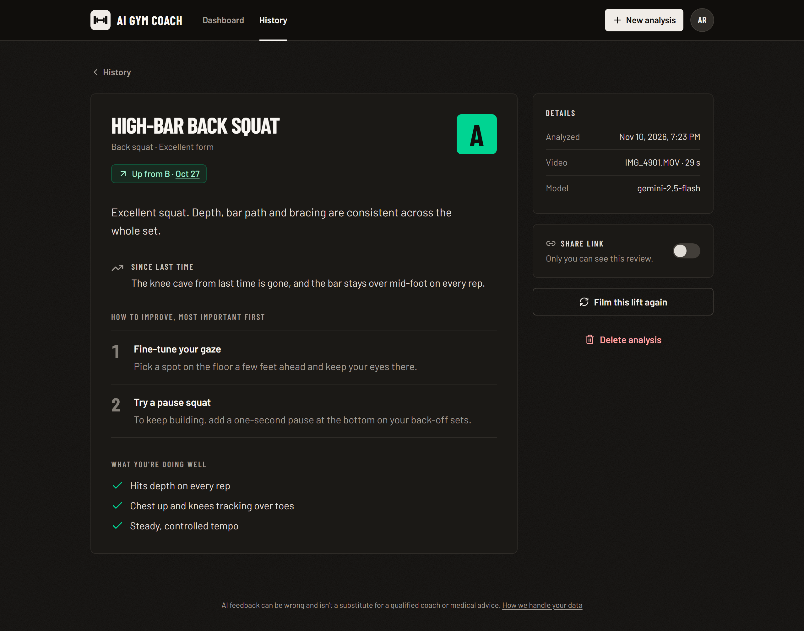
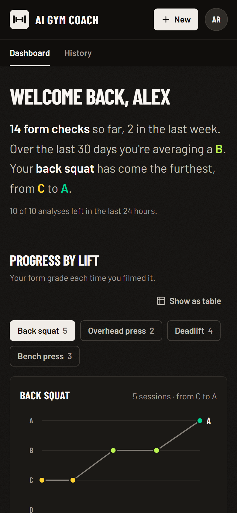
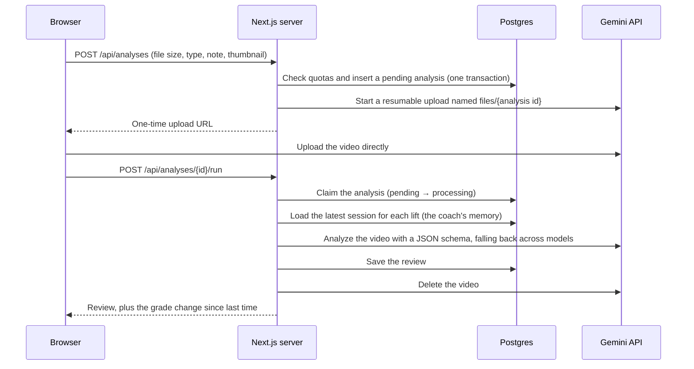

<div align="center">


# AI Gym Coach

**Film a set. Get a form grade, the corrections that matter, and a record of your progress, lift by lift.**

[](https://github.com/nstamonica/ai-gym-coach/actions/workflows/ci.yml)


**[Try it live → ai-personal-trainer-ns.vercel.app](https://ai-personal-trainer-ns.vercel.app)**

</div>



AI Gym Coach is a full-stack web app: upload a short video of a lift and Google's Gemini model reviews it like a strength coach would, with a grade from A to F, the three corrections that will help most, what you're doing well and any safety warnings. Every review is saved to your account, the coach compares each new set with your last session of the same lift, and a dashboard charts your form over time.

## Features

- **AI form review.** Upload an MP4, MOV or WebM (up to 90 seconds). Gemini returns schema-validated JSON: exercise, grade, summary, top three fixes, strengths, safety warning and a filming tip.
- **A coach with memory.** Each review is given your most recent session for every lift you've filmed, so it can tell you whether last time's corrections stuck ("the knee cave from last time is gone").
- **Progress tracking.** A dashboard with your grade trend per lift (keyboard-accessible chart with a table view), most improved lift and recent activity; a filterable, paginated history.
- **Accounts.** Email and password with password reset, optional GitHub and Google sign-in, change password, sign out of other devices.
- **Sharing.** Turn on an unguessable public link for any review, and turn it off again at any time.
- **Privacy controls.** Videos are deleted as soon as the review is ready. Download all your data as JSON, or delete your account and everything in it.
- **Cost guardrails.** Per-user and app-wide daily analysis quotas enforced in Postgres, and rate limits on the auth endpoints.

| Dashboard | Review | On a phone |
| --- | --- | --- |
|  |  |  |

## Tech stack

| Area | Choice |
| --- | --- |
| App | Next.js 16 (App Router, Server Components, Server Actions, Proxy), React 19, TypeScript (strict) |
| UI | Tailwind CSS 4 with a small custom design system (OKLCH color tokens, Barlow and Barlow Condensed), lucide icons, a hand-built accessible SVG chart |
| Auth | [Better Auth](https://better-auth.com): email/password, GitHub, Google; database sessions; rate limiting |
| Data | PostgreSQL with Drizzle ORM and SQL migrations. [PGlite](https://pglite.dev) (Postgres compiled to WebAssembly) for zero-setup local development and tests |
| AI | Gemini via `@google/genai`: video understanding, structured JSON output, model fallback chain |
| Validation | Zod |
| Testing | Vitest (unit and integration tests against a real Postgres), Playwright (end-to-end) |
| CI/CD | GitHub Actions; Vercel |

## How an analysis works



Some decisions worth calling out:

- **Videos never pass through the server.** The browser uploads straight to Gemini with a one-time URL, which sidesteps serverless body limits (about 4.5 MB on Vercel) and keeps the API key on the server.
- **The server names every upload.** The file is created as `files/{analysis id}` before the browser sends a byte, and the run endpoint takes only an analysis id that must belong to the signed-in user. A client can't get someone else's video analyzed.
- **Runs are idempotent and retryable.** Claiming an analysis is an atomic `UPDATE ... WHERE status = 'pending'`, so a double click can't pay for two analyses. Claims expire if a function dies mid-run. When every model is overloaded, the upload is kept so "Try again" doesn't re-upload the video. Re-running a finished analysis returns the saved result.
- **Quotas live in Postgres.** Serverless instances share no memory, so the quota check and the insert happen in one transaction under a per-user advisory lock (`pg_advisory_xact_lock`). Parallel requests can't slip past the limit. Failed analyses don't count against it.
- **Authorization sits next to the data.** Every query in [lib/server/analyses.ts](lib/server/analyses.ts) filters by the session's user id; [proxy.ts](proxy.ts) only does optimistic redirects. Data sent to the browser goes through view types that never include user ids, file names or thumbnail bytes.
- **Model output is untrusted.** Gemini answers in a JSON schema ([lib/analysis.ts](lib/analysis.ts)), and the response is still validated and normalized before it's stored. The lifter's free-text note is fenced in the prompt and treated as context, not instructions.
- **Zero-setup development, real Postgres everywhere.** Without `DATABASE_URL` the app runs an embedded Postgres (PGlite) and migrates it on startup. Tests use the same engine in memory with the real migrations, so there's no Docker and no mocked database.
- **Color is reserved for meaning.** The interface is chalk-white on warm near-black, so the only color on screen is the A–F grade scale, safety warnings and progress. Grades always show their letter too, so color is never the only cue, and every text color is checked for at least 4.5:1 contrast ([app/globals.css](app/globals.css)).

## Run it locally

You need [Node.js](https://nodejs.org) 22 or newer and a Gemini API key from [Google AI Studio](https://aistudio.google.com/apikey).

```bash
npm install
cp .env.example .env.local   # then add your GEMINI_API_KEY
npm run dev
```

Open http://localhost:3000 and create an account. There's no database to install: with no `DATABASE_URL`, data is stored in an embedded Postgres in `.data/pglite`, and its tables are created on startup. Password-reset emails are printed to the terminal in development.

**Demo data:** stop the dev server, run `npm run db:seed`, start it again and sign in as `demo@example.com` / `demo-lifter-2026` to see eight weeks of history across four lifts.

| Script | What it does |
| --- | --- |
| `npm run dev` | Start the dev server |
| `npm test` | Unit and integration tests (Vitest) |
| `npm run test:e2e` | End-to-end tests against the production build (run `npm run build` first) |
| `npm run lint` / `npm run typecheck` | ESLint / TypeScript |
| `npm run db:generate` | Create a migration after changing [lib/server/db/schema.ts](lib/server/db/schema.ts) |
| `npm run db:migrate` | Apply migrations to `DATABASE_URL` |
| `npm run db:studio` | Browse the database with Drizzle Studio |
| `npm run db:seed` | Create the demo account (add `-- --fresh` to reset the embedded database first) |

## Configuration

| Variable | Required | Description |
| --- | --- | --- |
| `GEMINI_API_KEY` | Yes | Gemini API key. Server-side only. |
| `BETTER_AUTH_SECRET` | In production | Signs sessions and tokens. Generate with `openssl rand -base64 32`. |
| `DATABASE_URL` | In production | Postgres connection string (pooled on serverless). Unset locally to use the embedded database. |
| `BETTER_AUTH_URL` | No | The app's public URL. Detected automatically on localhost and Vercel (including preview deployments). |
| `GITHUB_CLIENT_ID`, `GITHUB_CLIENT_SECRET` | No | Turns on "Continue with GitHub". Callback: `<url>/api/auth/callback/github`. |
| `GOOGLE_CLIENT_ID`, `GOOGLE_CLIENT_SECRET` | No | Turns on "Continue with Google". Redirect URI: `<url>/api/auth/callback/google`. |
| `RESEND_API_KEY`, `EMAIL_FROM` | No | Sends password-reset emails through [Resend](https://resend.com). Without them, "Forgot password?" is hidden in production. |
| `DAILY_ANALYSIS_LIMIT` | No | Analyses per user per rolling 24 hours (default 10). |
| `GLOBAL_DAILY_ANALYSIS_LIMIT` | No | Analyses across all users per rolling 24 hours (default 200). |
| `GEMINI_MODEL` | No | Comma-separated models to try in order. |

Upload limits (100 MB, 90 seconds) are in [lib/config.ts](lib/config.ts); the coaching prompt, grading scale and response schema are in [lib/analysis.ts](lib/analysis.ts).

## Testing

- **93 unit and integration tests** (Vitest, a few seconds). The data layer and API routes run against an in-memory Postgres with the real migrations: quotas (including racing requests), ownership checks, claim expiry, sharing and deletion. The coaching pipeline is tested with a mocked Gemini client: model fallback, retryable errors and limit checks.
- **11 end-to-end tests** (Playwright) against the production build, so the Content Security Policy is on: sign-up and sign-in flows, the open-redirect guard, the dashboard chart (including keyboard navigation), history filters, share links for signed-out visitors, data export, account deletion, and the full upload flow in a real browser with Gemini mocked at the network layer.

GitHub Actions runs lint, typecheck, both test suites and a production build on every push and pull request.

## Deploy to Vercel

1. **Create a Postgres database.** [Neon](https://neon.tech) has a free tier; adding it from the Vercel Marketplace sets `DATABASE_URL` for you and can give each preview deployment its own database branch.
2. **Import this repository** at [vercel.com/new](https://vercel.com/new).
3. **Add environment variables:** `GEMINI_API_KEY`, `BETTER_AUTH_SECRET` and `DATABASE_URL` (if the integration didn't add it), plus any optional ones above.
4. **Deploy.** [vercel.json](vercel.json) runs `npm run db:migrate` before each build, so new migrations are applied automatically. Give preview deployments a separate database (Neon's per-preview branches do this) so unmerged migrations never touch production.

The analysis route needs up to 300 seconds (`maxDuration`), which requires Vercel's Fluid Compute (on by default for new projects).

### Before sharing it publicly

- **Cap your Gemini key.** In the [Google Cloud console](https://console.cloud.google.com/apis/credentials), restrict the key to the Generative Language API and lower its daily quota; add a budget alert if billing is on. The app's own quotas are the first line of defense, not the only one.
- **Privacy.** On Gemini's free tier, Google may use submitted content to improve its products. If you have real users, enable billing on the key's project (paid-tier content isn't used that way) and keep the [privacy page](app/privacy/page.tsx) accurate.

## Security

- Sessions are httpOnly cookies backed by the database, with a signed 5-minute cookie cache; passwords are hashed with scrypt.
- Better Auth checks the request origin on auth endpoints; Server Actions check it too, and verify the session themselves.
- Sign-in, sign-up, password reset and account deletion are rate-limited (stored in Postgres so limits hold across serverless instances).
- A strict set of security headers and a Content Security Policy: scripts and connections are limited to the app's own origin and Gemini's upload endpoint.
- `?next=` redirects only allow same-site paths (tested against `//evil.com`, `/\t/evil.com` and friends).
- Share tokens are unguessable 144-bit random values that can be revoked; a lifter's notes are stripped from shared reviews in the data layer.
- Modules with secrets import `server-only`, so they can't end up in a client bundle.

## Project structure

```
app/
  page.tsx                        Landing page
  (auth)/                         Sign in, sign up, password reset
  (app)/                          Signed-in pages: dashboard, analyze, history, analyses/[id], settings
  share/[token]/                  Public, read-only shared review
  api/auth/[...all]/              Better Auth endpoints
  api/analyses/                   Create an analysis, run it, serve its thumbnail
  api/account/export/             Download all of a user's data
components/                       UI: report, progress chart, navigation, form controls
lib/
  analysis.ts                     Prompt, JSON schema and response parser (shared)
  exercises.ts, grades.ts         Exercise catalog and grade maths (shared)
  progress.ts                     Dashboard statistics (pure functions)
  server/
    auth.ts                       Better Auth configuration
    session.ts                    Data access layer for the current user
    analyses.ts                   Every database query for analyses
    coach.ts                      Gemini processing, fallbacks and limits
    db/                           Drizzle client and schema
drizzle/                          SQL migrations
e2e/                              Playwright tests
tests/                            Vitest integration tests
scripts/seed.ts                   Demo data
proxy.ts                          Optimistic auth redirects
```

## Limitations

AI form feedback can be wrong, and grades vary between runs and models, especially with poor camera angles. It isn't a substitute for a qualified coach or medical advice.
